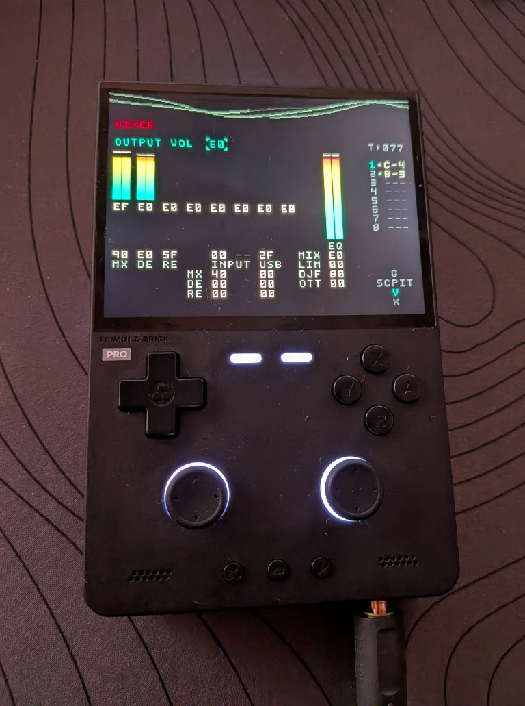

# m8c for TrimUI Brick Pro / NextUI

An ARM64 port of [m8c](https://github.com/laamaa/m8c) for using a
Teensy 4.1 running M8 Headless with a TrimUI Brick Pro running
[NextUI](https://github.com/LoveRetro/NextUI). It builds on
[m8c for TrimUI Brick / Knulli](https://github.com/myldy20/m8c-trimui-brick-knulli).

This repository contains the client and NextUI launcher, **not** the M8
Headless firmware.



## Tested setup

- TrimUI Brick Pro, NextUI v6.15.0, `tg5040`
- Teensy 4.1, M8 Headless firmware 6.6.3
- m8c 2.2.3 and SDL 3.2.20

The display, controls, USB audio capture, headphone output and volume buttons
have been tested on this setup. Noise and clicks remain audible on the Brick
Pro's built-in headphone output, including during silent playback with the
Teensy disconnected. Their cause has not been determined.

## Controls

| Brick Pro control | M8 action |
|---|---|
| D-pad | Navigate |
| A | Option |
| B | Edit |
| Select | Shift |
| Start | Play / stop |
| Select + Y | Exit client |

These are the NextUI button names for the classic layout. The port uses raw
joystick buttons, including Brick Pro-specific Play and exit mappings.

## Audio

The installed m8c configuration disables its own capture; the launcher uses ALSA
`arecord` and `aplay` to route 44.1 kHz stereo USB audio from the M8. When
NextUI has selected USB audio and its first non-internal card is a USB playback
device other than the M8, with a `PCM` mixer control and playback device 0,
the launcher uses that card for output. Otherwise it uses the Brick's
`Playback` PCM. If it switched from the USB sink to the internal sink, it
restores the USB sink on normal exit when the M8 is still connected. Set the
volume low before listening.

If the M8 is absent or the client fails to start, inspect `log.txt` in the
tool's directory. Forced termination or power loss can prevent normal cleanup;
reconnect the Teensy or reboot if routing behaves unexpectedly.

### USB headphone adapter

NextUI 6.15.0's volume buttons control the first non-internal audio card, which
may be the M8 rather than the USB headphone adapter. For the tested setup:

1. Keep the headphones off your ears. Connect the adapter to a USB data port
   on the hub; the Apple adapter may require headphones to be plugged in before
   it appears as an audio device.
2. Connect the Teensy after the adapter. Start M8 from Tools or boot with both
   devices connected.
3. Lower the volume before listening. Check the launcher `log.txt` for
   `Using USB output:`; if it reports an unavailable USB output, the launcher
   selected the Brick's internal output instead.

USB output is selected only at launch. If the selected card ID changes or
the audio bridge stops, the launcher stops M8 and returns to NextUI. The card
check runs every two seconds: it does not detect every disconnect/reconnect
or prevent NextUI from changing levels first. NextUI can change mixer levels
or card ordering on boot, sleep and reconnect; take headphones off before
reconnecting devices or waking the Brick, and check volume again. USB routing
and volume controls depend on the adapter and NextUI version.

On the tested setup, an Apple USB-C headphone adapter played M8 audio through
a hub with working volume buttons when it was the first external sound card.
The launcher used the internal output when the adapter was absent or the M8
was the first external card. Boot launch selected the adapter in one test,
but NextUI restored its volume to 80%; always lower it before listening.
Disconnecting the adapter during playback stopped the client and returned
to NextUI in the test.

## Optional boot launch

On the tested NextUI version, install the hook after installing the M8 tool:

1. Create `.userdata/tg5040/.hooks/boot.d/` on the SD card if needed.
2. Create `.userdata/tg5040/.m8-autostart-path` containing the absolute path
   of the installed M8 `.pak` directory on a single line. The path must be
   under `/mnt/SDCARD/Tools/tg5040/`.
3. Copy `m8-autostart.sync.sh` from this repository into that `boot.d`
   directory and make it executable on the device.
4. Restart with the Teensy connected. Set the volume low before connecting
   headphones.

The hook waits up to 20 seconds for M8 USB audio and a `/dev/ttyACM*` serial
device, then waits another two seconds for NextUI's audio monitor and starts
the installed M8 tool before NextUI's menu. The client itself identifies the
M8 serial device; the hook's serial check alone does not identify it. Exiting
M8 returns to the menu. If the required devices or launcher are missing, boot
continues to the menu. The hook appends to
`.userdata/tg5040/logs/m8-autostart.txt`; the M8 launcher has its own log.

On the tested setup, automatic launch, audio playback, returning to NextUI
with Select + Y, and booting to NextUI with the Teensy disconnected were
verified.

To disable boot launch, rename the hook so it no longer ends in `.sh`, or
remove that hook file.

### Optional LEDs off during boot launch

NextUI normally applies LED settings when its menu starts, which happens
after the synchronous M8 boot hook. To turn off the configurable Brick Pro
LEDs while M8 starts:

1. In NextUI's **Tools > LedControl**, set both **Brightness** and **Info
   brightness** to zero for all five zones. This also disables LED-based
   battery and sleep indications.
2. Copy `00-leds-off.sync.sh` from this repository to
   `.userdata/tg5040/.hooks/boot.d/` on the SD card, and make it executable
   on the device. Its name places it before `m8-autostart.sync.sh`.
3. Restart to apply it before M8 launches. The early firmware boot lights may
   still appear until NextUI runs its hooks.

The hook checks `.userdata/shared/ledsettings_brickpro.txt` and only applies
the all-off state when all five normal and info brightness values are zero.
Its log is `.userdata/tg5040/logs/leds-off.txt`. To disable the early hook,
rename it so it no longer ends in `.sh`, or remove it; use LedControl to
change the saved LED settings. If you made a backup of the settings file,
restore it while LedControl is closed and restart to apply it.

## Source and building

`m8c-source/` contains the modified m8c source used for the installed client.
`launch.sh`, `usb-output.sh`, and `sink-test.c` are the NextUI launcher and
audio-sink helpers.
The source snapshot retains upstream documentation; its generic audio guide
does not describe this launcher's ALSA bridge.

The original Brick port uses the following m8c build command in an ARM64 Linux
environment with SDL3 and libserialport development files available:

```sh
cd m8c-source
make CFLAGS="-DBRICK_RAW_CONTROLS"
```

The helper uses `dlopen` to access NextUI's `libmsettings.so` at runtime:

```sh
cc -O2 -o sink-test sink-test.c -ldl
```

Build against libraries compatible with the target NextUI system. The tested
installation uses SDL 3.2.20 and libserialport 0.1.1; the original Brick port's
[build scripts](https://github.com/myldy20/m8c-trimui-brick-knulli/tree/main/scripts)
show its SDL build configuration. These commands have not yet been verified
as a complete, reproducible NextUI build from this repository.

Run the USB output selection tests with:

```sh
python3 -m unittest discover -s tests -v
```

## Installation status

The working client currently exists as a NextUI Tools package on the tested
device. This repository preserves its modified source and launcher, but does
not yet provide a downloadable package or a complete automated installation
procedure. The runtime package needs the ARM64 client as `m8c-bin`, the
`sink-test` helper, `usb-output.sh`, compatible SDL3 and libserialport
libraries under `lib/`, and an m8c configuration with `audio_enabled=false`.

## Credits and licenses

- [m8c](https://github.com/laamaa/m8c), by Jonne Kokkonen and contributors:
  see [m8c-source/LICENSE](m8c-source/LICENSE), including font and other
  third-party notices.
- [m8c for TrimUI Brick / Knulli](https://github.com/myldy20/m8c-trimui-brick-knulli),
  by myldy20: see [LICENSE-Brick-port](LICENSE-Brick-port).
- [SDL](https://github.com/libsdl-org/SDL) and
  [libserialport](https://sigrok.org/wiki/Libserialport) are runtime
  dependencies; binaries are not included here.
- [NextUI](https://github.com/LoveRetro/NextUI) provides the system settings
  library used by the sink helper.
